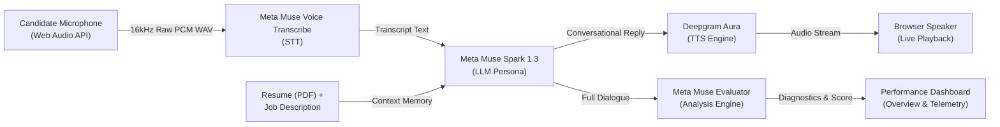

# InterVibe 🎙️⚡

> **Next-Generation Real-Time AI Verbal Mock Interview Simulator & Performance Diagnostics Platform**  
> *Engineered for the Meta AI Developer Hackathon*

[](https://nextjs.org/)
[](https://react.dev/)
[](https://www.typescriptlang.org/)
[](https://tailwindcss.com/)
[](https://ai.meta.com/)
[](https://deepgram.com/)
[](LICENSE)

---

## 🌟 Overview

**InterVibe** bridges the gap between passive technical interview preparation and high-stakes live verbal loops. By combining real-time speech processing, resume memory injection, dynamic persona emulation, and conversational AI, InterVibe replicates realistic technical screeners and system design interviews.

Candidates speak naturally using low-latency **Push-to-Talk**, receive real-time verbal rebuttals from lifelike AI interviewer personas, and exit every session with **exhaustive diagnostics, executive scores, and targeted practice drills**.

---

## ✨ Key Features

### 🎙️ Direct 16kHz PCM Push-to-Talk Audio Stream
- **Zero-Accidental-Cutoffs**: Push-to-talk audio loop (hold `Spacebar` to speak, release to process) eliminates premature VAD silences during complex thought pauses.
- **Client-Side Resampling**: Web Audio API `AudioContext` and `ScriptProcessorNode` capture 32-bit float raw audio and downsample linearly to 16,000Hz 16-bit mono WAV in-browser before streaming to STT.

### 🧠 Meta Muse Spark 1.3 LLM Reasoning
- Powered by **Meta Muse Spark 1.3 Contributor** via the Meta Model API.
- Implements strict persona roleplay, one-question-at-a-time verbal discipline, context-aware technical cross-examination, and dynamic difficulty scaling.
- Automated fallback to Groq Cloud ensures high availability.

### 🗣️ Conversational Speech-to-Text & Text-to-Speech
- **STT**: **Meta Muse Voice Transcribe 1.0** with fallback to Groq Whisper Large v3.
- **TTS**: Low-latency neural synthesis via **Deepgram Aura** (Asteria, Orion, Luna) with automatic fallback to native Web Speech Synthesis.

### 📄 Contextual Resume Parsing & Memory Injection
- Server-side parsing (`pdf2json`) extracts past projects, tech stacks, and seniority bars directly into the interviewer’s system memory.
- The AI cross-examines candidate claims against specific Job Description (JD) requirements.

### 📊 Comprehensive Post-Session Diagnostics & Analytics
- **Executive Evaluator Assessment**: High-level qualitative summary of performance against seniority bars.
- **Quantified Scoring**: Overall readiness index, verbal score, and practice speaking time.
- **Actionable Vectors**: Categorized breakdown of *Observed Strengths*, *Areas for Improvement*, and *Recommended Practice Drills*.
- **Radar & Skill Competency Diagnostics**: Granular breakdowns across System Architecture, Technical Depth, Problem Solving, and Communication Clarity.

### 🎨 Clean Developer Experience & Adaptive UI
- **Design Presets**: Switchable between **▲ Vercel Minimalist Monochrome** and **⚡ Supabase Emerald Accents**.
- **Dark & Light Modes**: Full semantic theme support with high-contrast readability.
- **Interactive Studio**: Animated avatar breathing rings, dynamic soundwave equalizer bars, and real-time auto-scrolling transcript console.

---

## 🎭 Interviewer Personas

| Persona | Role & Archetype | Voice Model | Target Tone |
| :--- | :--- | :--- | :--- |
| **Sarah Chen** | Senior Technical Recruiter (Linear) | Deepgram Aura Asteria (Female) | Warm, behavioral, culture alignment, structured STAR probing |
| **Michael Vance** | Strict Engineering Manager (Stripe) | Deepgram Aura Orion (Male) | Direct, rigorous, architectural trade-offs, edge-case pressure |
| **Emma Watson** | British Technical Lead (DeepMind) | Deepgram Aura Luna (Female) | Deep technical precision, distributed systems, clean code standards |

---

## 🏗️ Architecture & Pipeline



---

## 📂 Repository Structure

```
InterVibe/
├── src/
│   ├── app/
│   │   ├── api/
│   │   │   ├── analyze-interview/   # Meta Muse Spark session evaluation
│   │   │   ├── chat/                # Meta Muse Spark 1.3 LLM conversational loop
│   │   │   ├── extract-resume/      # PDF text extraction route
│   │   │   ├── stt/                 # Meta Muse Voice Transcribe audio endpoint
│   │   │   └── tts/                 # Deepgram Aura text-to-speech endpoint
│   │   ├── auth/login/              # Authentication view
│   │   ├── dashboard/
│   │   │   ├── billing/             # Subscription & tier management
│   │   │   ├── interview/           # Live Avatar Studio, Push-to-Talk, & Config
│   │   │   ├── overview/            # Performance diagnostics, KPIs, & history
│   │   │   └── profile/             # Profile, General Settings & appearance presets
│   │   ├── layout.tsx               # Root layout with ThemeProvider & Toaster
│   │   └── page.tsx                 # Landing / Redirect
│   ├── components/
│   │   ├── layout/                  # Responsive app sidebar, header, breadcrumbs
│   │   ├── themes/                  # Theme switcher & mode toggle components
│   │   └── ui/                      # shadcn/ui components (Radix primitives)
│   ├── config/                      # Navigation and persona configuration
│   ├── hooks/                       # Custom responsive and theme hooks
│   ├── lib/                         # Utility helpers and cn() class merge
│   ├── store/                       # Zustand stores (Auth, Sessions, Diagnostics)
│   └── styles/                      # Tailwind CSS v4 & custom keyframe animations
├── public/                          # Avatars, logos, and static assets
├── .env.example                     # Environment template
├── package.json                     # Scripts and dependencies
└── tsconfig.json                    # TypeScript configuration
```

---

## 🚀 Getting Started

### ⚡ One-Click Quick Start (Windows)

On Windows, you can simply double-click `startup.bat` in the project root or run:

```cmd
startup.bat
```

The script automatically verifies your Node.js/npm runtime, generates `.env.local` from `.env.example` if absent, installs dependencies if `node_modules` is missing, and provides a menu to launch the dev server with automatic browser opening.

---

### 1. Prerequisites
- **Node.js**: `18.18+` or `20+`
- **npm** or **pnpm**
- Modern Chromium-based browser (Google Chrome, Brave, Edge) with microphone permissions enabled.

### 2. Clone & Install

```bash
git clone https://github.com/your-username/intervibe.git
cd intervibe
npm install
```

### 3. Environment Variables Configuration

Create a `.env.local` file in the root directory:

```bash
cp .env.example .env.local
```

Populate the keys in `.env.local`:

```env
# Meta Model API - LLM (Meta Muse Spark 1.3 Contributor)
MODEL_API_KEY=your_meta_model_api_key
META_API_BASE=https://api.meta.ai/v1
SPARK_MODEL_ID=muse-spark-1.3-contributor

# Meta Muse Voice Transcribe (STT)
TRANSCRIBE_MODEL_ID=muse-voice-transcribe-1.0
MUSE_API_KEY=your_meta_muse_api_key

# Deepgram Aura (Primary TTS)
DEEPGRAM_API_KEY=your_deepgram_aura_api_key

# Groq Cloud (High-Availability Fallback)
GROQ_API_KEY=your_groq_api_key
GROQ_MODEL=openai/gpt-oss-120b

# App Metadata
NEXT_PUBLIC_APP_NAME=InterVibe
```

### 4. Run the Development Server

```bash
npm run dev
```

Open [http://localhost:3000](http://localhost:3000) in your browser.

### 5. Production Build Verification

```bash
npm run build
npm run start
```

---

## 🎯 How to Use InterVibe

1. **Upload Resume**: Upload your resume (`.pdf`) or select "Use Demo Resume". InterVibe extracts key technical experience, frameworks, and achievements into the interviewer's working memory.
2. **Configure Loop**: Specify your target job title, job description, seniority level, interview focus (System Design, Behavioral, or Mixed), and preferred interviewer persona.
3. **Enter Studio**: 
   - Hold the **Spacebar** down while speaking your answer.
   - Release the **Spacebar** to stream your voice to the transcription model.
   - Listen to the AI interviewer respond naturally via neural audio with real-time reactive avatar states.
4. **Review Diagnostics**: Click **End Interview** to generate your AI Evaluator Report, comprehensive scores, strengths, improvement vectors, and recommended drill roadmap.

---

## 🛠️ Tech Stack & Integrations

- **Framework**: [Next.js 16](https://nextjs.org/) (App Router, Turbopack)
- **Frontend**: [React 19](https://react.dev/), [TypeScript 5.7](https://www.typescriptlang.org/), [Tailwind CSS v4](https://tailwindcss.com/)
- **UI Components**: [shadcn/ui](https://ui.shadcn.com/), [Radix UI](https://www.radix-ui.com/), [Lucide React](https://lucide.dev/)
- **State Management**: [Zustand](https://github.com/pmndrs/zustand) with `localStorage` persistence
- **LLM Engine**: [Meta Muse Spark 1.3 Contributor](https://ai.meta.com/) (Meta AI)
- **Speech-to-Text**: [Meta Muse Voice Transcribe 1.0](https://ai.meta.com/) / Groq Whisper Large v3
- **Text-to-Speech**: [Deepgram Aura](https://deepgram.com/) (Asteria, Orion, Luna) + Web Speech API fallback
- **Document Processing**: `pdf2json`
- **Feedback & Notifications**: [Sonner](https://sonner.emilkowal.ski/)

---

## 🏆 Hackathon Context

This project was built for the **Meta AI Developer Hackathon**, focusing on practical, high-impact conversational applications powered by Meta's frontier generative AI models (**Meta Muse Spark 1.3** and **Meta Muse Voice Transcribe**).

---

## 📄 License

Distributed under the MIT License. See `LICENSE` for more information.
