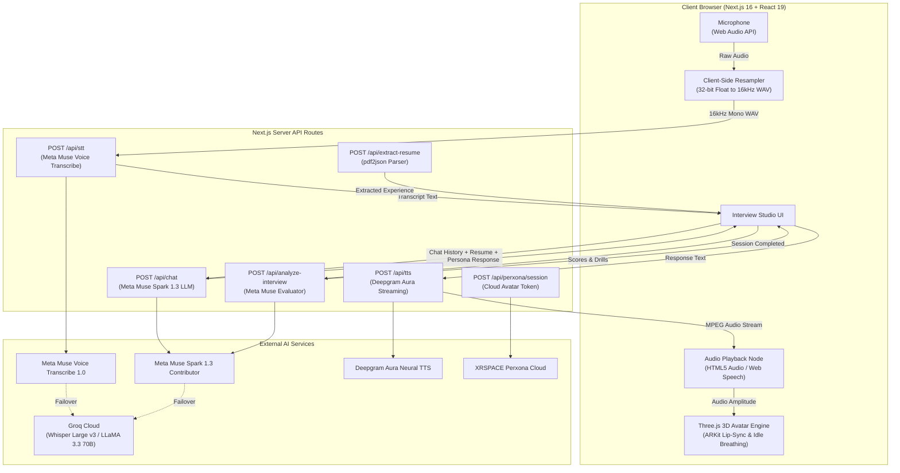

# InterVibe 🎙️⚡

> **Next-Generation Real-Time AI Verbal Mock Interview Simulator & Performance Diagnostics Platform**  
> *Engineered for the Meta AI Developer Hackathon*

[](https://nextjs.org/)
[](https://react.dev/)
[](https://www.typescriptlang.org/)
[](https://tailwindcss.com/)
[](https://threejs.org/)
[](https://www.framer.com/motion/)
[](https://ai.meta.com/)
[](https://deepgram.com/)
[](https://groq.com/)
[](LICENSE)

---

## 📑 Table of Contents

- [🌟 Overview](#-overview)
- [✨ Key Features](#-key-features)
- [🎭 Interviewer Personas](#-interviewer-personas)
- [🏗️ Architecture & Pipeline](#-architecture--pipeline)
- [📂 Repository Structure](#-repository-structure)
- [🎨 10 Switchable Design Presets](#-10-switchable-design-presets)
- [🚀 Getting Started](#-getting-started)
  - [⚡ One-Click Quick Start (Windows)](#-one-click-quick-start-windows)
  - [Manual Setup](#manual-setup)
  - [Environment Variables Configuration](#environment-variables-configuration)
- [🎯 How to Use InterVibe](#-how-to-use-intervibe)
- [🛠️ Tech Stack & Integrations](#️-tech-stack--integrations)
- [🏆 Hackathon Context](#-hackathon-context)
- [📄 License](#-license)

---

## 🌟 Overview

**InterVibe** bridges the gap between passive technical interview preparation and high-stakes live verbal loops. Most interview candidates practice coding algorithms in silence or read text-based solutions, leaving them vulnerable to the verbal communication breakdowns, rapid architectural cross-examination, and pacing pressure of live recruiter and hiring manager loops.

InterVibe delivers a hyper-realistic, end-to-end simulated interview experience:
- Candidates speak naturally using zero-latency **Push-to-Talk audio streaming**.
- Interactive **3D photorealistic human avatars** react with lip-syncing, idle breathing, and eye tracking.
- Frontier AI models (**Meta Muse Spark 1.3** and **Deepgram Aura**) emulate specialized technical recruiter and engineering manager personas.
- Candidates receive **instant qualitative diagnostics**, skill radar metrics, speaking telemetry, and personalized practice drills after every session.

---

## ✨ Key Features

### 👤 Photorealistic 3D & 2D Talking Avatars
- **Three.js WebGL 3D Avatar Engine**: Renders high-fidelity 3D character avatars (`sarah.glb`, `michael.glb`, `emma.glb`) with realistic skin textures, studio 3-point lighting, idle chest breathing, realistic eye blinking, head tilt, and ARKit facial blendshapes for natural lip synchronization.
- **XRSPACE Perxona Connect Cloud Streaming**: Seamless fallback and integration with Perxona Connect SDK (`/api/perxona/session`) for cloud-streamed talking avatar video loops.
- **2D Reactive Avatar Mode**: Lightweight 2D portrait mode with animated audio rings, state indicators (`Speaking`, `Thinking`, `Listening`, `Idle`), and dynamic soundwave equalizer bars.
- **Executive Framing**: Camera perspectives calibrated for professional webcam composition with balanced headroom.

### 🎙️ Direct 16kHz PCM Push-to-Talk Audio Stream
- **Zero Accidental Cutoffs**: Hold `Spacebar` to speak and release to process. Eliminates premature Voice Activity Detection (VAD) silences while thinking through complex distributed systems trade-offs.
- **Client-Side Resampling**: Web Audio API (`AudioContext` and `ScriptProcessorNode`) captures 32-bit float raw microphone audio and downsamples linearly in-browser to standard 16,000Hz 16-bit mono WAV before streaming to the STT API.

### 🧠 Meta Muse Spark 1.3 LLM Reasoning
- Powered by **Meta Muse Spark 1.3 Contributor** via the Meta Model API.
- Implements strict persona roleplay, one-question-at-a-time verbal pacing discipline, conversational interruptions, and adaptive difficulty scaling based on candidate responses.
- **Automatic High-Availability Fallback**: Transparently fails over to Groq Cloud (LLaMA 3.3 70B Versatile / gpt-oss-120b) if the primary model reaches rate limits.

### 🗣️ Conversational Speech-to-Text & Neural TTS
- **STT**: **Meta Muse Voice Transcribe 1.0** with fallback to **Groq Whisper Large v3** for sub-second audio transcription.
- **TTS**: Low-latency neural speech synthesis via **Deepgram Aura** (`aura-asteria-en`, `aura-orion-en`, `aura-luna-en`) with automatic browser-native Web Speech API fallback.

### 📄 Contextual Resume Parsing & Memory Injection
- Server-side PDF extraction via `pdf2json` extracts work experience, project bullet points, and tech stacks directly into the interviewer’s system prompt memory.
- Cross-examines candidate claims against specific Job Description (JD) requirements and seniority expectations.

### 📊 Comprehensive Post-Session Diagnostics & Telemetry
- **Executive Evaluator Assessment**: High-level qualitative assessment of performance benchmarked against industry seniority bars (Junior, Mid, Senior, Staff/Lead).
- **Quantified Scoring**: Overall readiness index, verbal score, filler word analysis, and total practice speaking time.
- **Actionable Vectors**: Categorized breakdown of *Observed Strengths*, *Areas for Improvement*, and *Recommended Practice Drills*.
- **Skill Competency Radar**: Granular scores across System Architecture, Technical Depth, Problem Solving, and Communication Clarity.
- **Session History Persistence**: Client-side Zustand stores automatically persist all session evaluations and transcripts to `localStorage`.

### 🌐 Modern High-Conversion Landing Page
- Engineered with dark neon aesthetic (`#0f1211` background, `#78fcd6` emerald/cyan accents).
- Interactive hero section with live dashboard preview and soundwave animation.
- Dynamic Bento Grid showcasing core platform capabilities:
  - *Actionable Guidance Illustration*
  - *Calibration Illustration*
  - *Diagnostic Analysis Illustration*
  - *Drill Loop Illustration*
  - *Readiness Telemetry Illustration*
  - *Live Interview Illustration*
- Interactive Pricing Matrix with monthly/annual billing toggle across 4 tiers (**Free**, **Hustler**, **Pro**, **Teams**).
- Testimonial grid, social proof badges, and interactive FAQ accordion.
- Smooth scroll and entry reveals powered by **Framer Motion**.

### 💳 Tier Management & Invoice Telemetry
- Subscription tier management (Free Starter, Hustler, Pro Unlimited, Teams Enterprise).
- Interactive invoice modal with history breakdown.
- One-click CSV export for billing records and interview session credits.

---

## 🎭 Interviewer Personas

| Persona | Role & Archetype | Voice Model | Target Tone & Behavior | 3D Asset |
| :--- | :--- | :--- | :--- | :--- |
| **Sarah Chen** | Senior Technical Recruiter (Linear) | Deepgram Aura Asteria (Female) | Warm, encouraging, behavioral STAR probing, culture alignment | `sarah.glb` / `sarah.webp` |
| **Michael Vance** | Strict Engineering Manager (Stripe) | Deepgram Aura Orion (Male) | Direct, rigorous, architectural trade-offs, edge-case pressure | `michael.glb` / `michael.webp` |
| **Emma Watson** | British Technical Lead (DeepMind) | Deepgram Aura Luna (Female) | Deep technical precision, distributed systems, clean code standards | `emma.glb` / `emma.webp` |

---

## 🏗️ Architecture & Pipeline



---

## 📂 Repository Structure

```
InterVibe/
├── src/
│   ├── app/
│   │   ├── api/
│   │   │   ├── analyze-interview/     # Meta Muse Spark session evaluation & scoring
│   │   │   ├── chat/                  # Meta Muse Spark 1.3 LLM conversational loop
│   │   │   ├── extract-resume/        # PDF resume parsing endpoint (pdf2json)
│   │   │   ├── perxona/session/       # XRSPACE Perxona Connect token provider
│   │   │   ├── stt/                   # Meta Muse Voice Transcribe & Groq Whisper endpoint
│   │   │   └── tts/                   # Deepgram Aura text-to-speech audio streaming
│   │   ├── auth/login/                # User authentication & onboarding
│   │   ├── dashboard/
│   │   │   ├── billing/               # Plan tiers, invoice history & CSV export
│   │   │   ├── interview/             # Live Interview Room, Push-to-Talk, & Config
│   │   │   ├── overview/              # Analytics dashboard, KPIs, & session history
│   │   │   └── profile/               # Appearance theme switcher, avatars & settings
│   │   ├── layout.tsx                 # Root layout with ThemeProvider & Sonner
│   │   └── page.tsx                   # High-converting modern landing page
│   ├── components/
│   │   ├── avatar/
│   │   │   └── interactive-avatar.tsx # Three.js WebGL 3D avatar & Perxona renderer
│   │   ├── landing/                   # Hero, Bento grid, Testimonials, FAQ & Pricing
│   │   │   ├── bento/                 # Feature illustrations and telemetry widgets
│   │   │   ├── animated-section.tsx   # Framer motion viewport trigger
│   │   │   ├── hero-section.tsx       # Landing hero with interactive CTA
│   │   │   ├── dashboard-preview.tsx  # Live mock interview preview card
│   │   │   ├── pricing-section.tsx    # Tier matrix with monthly/annual switch
│   │   │   └── faq-section.tsx        # Accordion FAQ
│   │   ├── layout/                    # Responsive sidebar, navigation & breadcrumbs
│   │   ├── themes/                    # Theme preset selector & dark/light toggle
│   │   └── ui/                        # shadcn/ui components (Radix primitives)
│   ├── config/                        # Navigation configuration & personas
│   ├── hooks/                         # Responsive hooks & theme state
│   ├── lib/                           # Utility helpers, audio tools & api client
│   ├── store/                         # Zustand state stores (Auth, Sessions, Telemetry)
│   └── styles/
│       ├── themes/                    # 10 custom CSS theme stylesheets
│       ├── globals.css                # Tailwind CSS v4 directives
│       └── theme.css                  # Theme injection root variables
├── public/
│   ├── avatars/                       # 3D GLTF models & webp textures (Sarah, Michael, Emma)
│   ├── images/                        # Landing page assets & Bento grid diagrams
│   └── logos/                         # Company logos for social proof banner
├── .env.example                       # Environment configuration template
├── package.json                       # Scripts, Next.js 16, React 19, Three.js & dependencies
├── startup.bat                        # One-click Windows setup & launcher script
└── tsconfig.json                      # TypeScript configuration
```

---

## 🎨 10 Switchable Design Presets

InterVibe features 10 fully customized design themes accessible from the Profile & Settings menu, with complete support for both Light and Dark modes:

| Theme Preset | Visual Identity & Style |
| :--- | :--- |
| **▲ Vercel** | Ultra-clean minimalist monochrome with sharp borders |
| **⚡ Supabase** | High-contrast dark charcoal with radiant emerald green accents |


---

## 🚀 Getting Started

### ⚡ One-Click Quick Start (Windows)

On Windows, double-click `startup.bat` in the project root or run:

```cmd
startup.bat
```

The script will automatically:
1. Verify that **Node.js** and **npm** are installed.
2. Create `.env.local` from `.env.example` if it doesn't already exist.
3. Install dependencies (`npm install`) if `node_modules` is absent.
4. Launch the Next.js development server at [http://localhost:3000](http://localhost:3000) and open your default browser.

---

### Manual Setup

#### 1. Prerequisites
- **Node.js**: `18.18+` or `20+`
- **npm** or **pnpm**
- Modern Chromium-based browser (Chrome, Brave, Edge) with microphone permissions granted.

#### 2. Clone & Install

```bash
git clone https://github.com/your-username/intervibe.git
cd intervibe
npm install
```

#### 3. Environment Variables Configuration

Copy `.env.example` to create your local environment file:

```bash
cp .env.example .env.local
```

Configure your API keys in `.env.local`:

```env
# Meta Model API - LLM (Meta Muse Spark 1.3 Contributor)
MODEL_API_KEY=your_meta_model_api_key_here
META_API_BASE=https://api.meta.ai/v1
SPARK_MODEL_ID=muse-spark-1.3-contributor

# Meta Muse Voice Transcribe (STT) - Primary
TRANSCRIBE_MODEL_ID=muse-voice-transcribe-1.0
MUSE_API_KEY=your_meta_muse_api_key_here

# Deepgram Aura TTS (Primary Neural Audio)
DEEPGRAM_API_KEY=your_deepgram_aura_api_key_here

# Groq Cloud (High-Availability Fallback for STT & LLM)
GROQ_API_KEY=your_groq_api_key_here
GROQ_MODEL=openai/gpt-oss-120b

# App Metadata
NEXT_PUBLIC_APP_NAME=InterVibe

# XRSPACE Perxona Connect (Optional: Cloud-Streamed Talking Avatars)
PERXONA_API_BASE_URL=https://console.perxona.ai/asia
PERXONA_CONNECT_PUBLISHABLE_KEY=your_perxona_publishable_key_here
PERXONA_CONNECT_SECRET_KEY=your_perxona_secret_key_here
```

#### 4. Run the Development Server

```bash
npm run dev
```

Visit [http://localhost:3000](http://localhost:3000) to view the application.

#### 5. Production Build Verification

```bash
npm run build
npm run start
```

---

## 🎯 How to Use InterVibe

```
[1. Setup Context] ──► [2. Select Persona] ──► [3. Verbal Interview Studio] ──► [4. Diagnostics Report]
   Upload Resume          Choose Sarah,             Hold Spacebar to speak         Readiness Index &
   & Paste JD             Michael, or Emma          Real-time 3D Avatar reacts     Actionable Drills
```

1. **Upload Resume & Set Target Role**: Upload your resume (`.pdf`) or click **Use Demo Resume**. InterVibe parses your past technical stack, notable projects, and career milestones.
2. **Configure Interview Focus**: Specify the target job title, job description, seniority level, and focus area (System Design, Behavioral / STAR, or Mixed).
3. **Select Your Interviewer**: Choose from Sarah Chen (Recruiter), Michael Vance (Strict EM), or Emma Watson (Tech Lead). Toggle between 3D photorealistic avatar and 2D mode.
4. **Conduct the Verbal Loop**:
   - Hold the **Spacebar** while answering.
   - Speak naturally into your microphone.
   - Release the **Spacebar** to send the downsampled 16kHz audio stream.
   - Listen to the interviewer reply with low-latency neural voice synthesis while watching the avatar lip-sync in real time.
5. **Review In-Depth Diagnostics**: End the session to generate your comprehensive evaluation report with quantified scoring, filler word counts, radar skill charts, and personalized practice drills.

---

## 🛠️ Tech Stack & Integrations

| Layer | Technology / Library | Description |
| :--- | :--- | :--- |
| **Framework** | [Next.js 16](https://nextjs.org/) (App Router, Turbopack) | Server-side rendering, API route handlers, and streaming |
| **Frontend Core** | [React 19](https://react.dev/), [TypeScript 5.7](https://www.typescriptlang.org/) | Concurrent React features and type-safe components |
| **Styling** | [Tailwind CSS v4](https://tailwindcss.com/) | Modern utility-first CSS engine with CSS custom properties |
| **3D Avatar Engine** | [Three.js](https://threejs.org/) | WebGL rendering, GLTF loader, and ARKit blendshape lip-sync |
| **Animations** | [Framer Motion](https://www.framer.com/motion/) | Smooth viewport animations, landing transitions, and bento reveals |
| **UI Components** | [shadcn/ui](https://ui.shadcn.com/), [Radix UI](https://www.radix-ui.com/), [Lucide](https://lucide.dev/) | Accessible, composable UI building blocks |
| **Primary LLM** | [Meta Muse Spark 1.3 Contributor](https://ai.meta.com/) | Verbal interview reasoning, persona roleplay, and evaluations |
| **Primary STT** | [Meta Muse Voice Transcribe 1.0](https://ai.meta.com/) | Real-time audio transcription |
| **Neural TTS** | [Deepgram Aura](https://deepgram.com/) | Low-latency natural human voice synthesis (Asteria, Orion, Luna) |
| **Failover AI** | [Groq Cloud](https://groq.com/) | Whisper Large v3 STT & LLaMA 3.3 70B Versatile backup inference |
| **Cloud Avatars** | [XRSPACE Perxona Connect](https://console.perxona.ai/) | Cloud talking avatar streaming integration |
| **Document Parser** | `pdf2json` | Serverless binary PDF text extraction |
| **State Management**| [Zustand](https://github.com/pmndrs/zustand) | Client-side state and `localStorage` session persistence |
| **Toast Notifications** | [Sonner](https://sonner.emilkowal.ski/) | Non-intrusive alert and notification system |

---

## 🏆 Hackathon Context

This project was built for the **Meta AI Developer Hackathon**, highlighting the real-world utility of Meta's frontier generative AI models (**Meta Muse Spark 1.3** and **Meta Muse Voice Transcribe 1.0**) combined with WebGL 3D graphics, client-side audio DSP, and low-latency neural synthesis.

---

## 📄 License

Distributed under the **MIT License**. See [`LICENSE`](LICENSE) for details.
